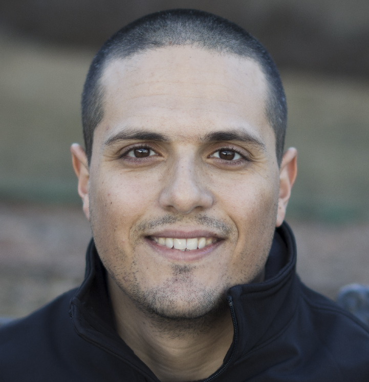

<!-- Old address: https://www.kour.me/home (also https://sites.google.com/view/kour/home). Page title: "George Kour, Ph.D." Source: Google Takeout PUBLISHED/Home.html, cross-checked with the live page on 2026-11-25. -->

## George Kour, Ph.D.

Research Scientist

IBM Research Labs

I am a senior researcher in the Language and Conversation Group at IBM Research, focusing on the evaluation, safety, and security of large language models and AI agents. My work examines how AI systems make decisions, express preferences, and behave in complex or adversarial settings, with an emphasis on developing methods for assessing reliability, alignment, and risk.

I also teach in the Computer Science faculty at the Academic College of Tel Aviv-Yaffo, where I lead both introductory and advanced machine learning courses.

I earned my bachelor's degree in computer engineering from the Technion, followed by a master's at Tel Aviv University, where I worked with Prof. Dana Ron and Dr. Raid Saabni on a thesis about online handwriting recognition in Arabic. For my Ph.D. in computational neuroscience at Haifa University’s Sagol Department of Neurobiology, I studied cognitive models of attention and motivation, focusing on how the brain represents different states, under the guidance of Dr. Genela Morris.

### Research Interests:

My research interests are mainly focused on the foundation of learning mechanisms, encompassing both artificial and natural systems, including:

Natural Language Processing - Large Language Models - Generative Models - AI Safety - Computational Neuroscience - Cognitive Modeling - Reinforcement Learning.

### Online Presence:

- Email: gkour(at)ibm.com / kourgeorge(at)gmail.com
- My [**CV**](https://drive.google.com/file/d/1jKShjChFSWVyrwjqUwpUAGDPcxdn__so/view?usp=sharing) *(updated May. 2026)*.
- [Researcher page](http://researcher.watson.ibm.com/researcher/view.php?person=ibm-GKOUR) at **IBM Research**.
- My [**linked-in**](https://www.linkedin.com/in/georgekour/) profile
- A link to my [**github**](https://github.com/kourgeorge) account
- My [**page**](https://scholar.google.com/citations?hl=en&user=Yx8ov1wAAAAJ) on Google Scholar
- My [**Researchgate**](https://www.researchgate.net/profile/George_Kour) page
- My [**dblp**](https://dblp.uni-trier.de/pers/hd/k/Kour:George) page.

---

### Supported Organizations:

Being part of a nation displaced from its homeland, and simply as a human being, I'm deeply passionate about human rights, particularly those of refugees.

I support the following organizations:

- [**Sadaka-Reut**](http://www.reutsadaka.org/): an Arab-Jewish Partnership Organization. *Active Role: Board of Directors Member.*
- [**SAMS**](https://www.sams-usa.net/): The Syrian American Medical Society. *Active Role: Volunteer & Honorary member 2017-2018.*
- [***tsofen***](http://www.tsofen.org/): An organization promoting Arab citizens' representation in hi-tech firms. *Active Role: Volunteer in the One-On-One program.*

---

© ALL RIGHTS RESERVED
